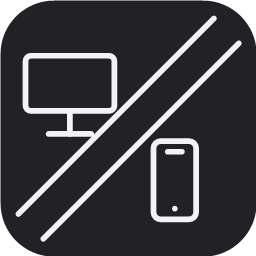

# parallexity



Бесплатный пульт для Windows с телефона. Музыка, громкость приложений, мышь и клавиатура — в браузере телефона, через домашнюю сеть.

**[Скачать для Windows x64](https://github.com/qxxivo/parallexity/releases/latest)** · [Исходники](https://github.com/qxxivo/parallexity) · [Сообщить о проблеме](https://github.com/qxxivo/parallexity/issues)

## Запуск

1. Скачай `parallexity-win-x64.zip` из последнего релиза и распакуй в папку с правами записи. Сохрани документацию и папку `licenses` рядом с EXE.
2. Запусти `parallexity.exe`. Установка .NET не нужна. Поддерживаются Windows 10 версии 2004 и новее и Windows 11, x64.
3. Подключи ПК и телефон к одному домашнему роутеру. ПК может быть подключён кабелем.
4. Если Windows запросит доступ к сети, разреши приложение для частных сетей.
5. Отсканируй QR-код камерой телефона, назови устройство и подтверди подключение на ПК.
6. Для тачпада и ввода текста включи «Разрешить мышь и клавиатуру» в окне ПК.

Домен, платный сервер, аккаунт и мобильное приложение не нужны. Закрытие окна оставляет пульт в меню рядом с часами. Там доступны открытие, проверка обновлений, перезапуск и выход.

## Новое в 0.4.0

- Графитовая и белая палитра, новый логотип с монитором, телефоном и двумя диагоналями.
- Навигация снизу и крупные кнопки; клавиатура и текст спрятаны в раскрываемый блок.
- Более частая передача движения и сохранение дробных смещений для точного режима.
- Удержание пальца для перетаскивания. При потере связи или разрешения кнопка мыши отпускается автоматически примерно за секунду.
- Новые значки браузера, EXE и меню возле часов.

## Возможности

- Общая громкость, отключение звука, отдельная громкость аудиосессий приложений.
- Выбор медиасессии, название трека/видео, воспроизведение, пауза и переключение треков.
- Тачпад: курсор, точный режим, касание для клика, прокрутка двумя пальцами. Удерживай палец примерно полсекунды, затем двигай — перетаскивание; отпусти палец — отпусти мышь.
- Левый, правый и двойной клик, стрелки, Enter, Tab, Esc, Backspace.
- Ввод текста до 500 символов, русский и emoji; перенос строки нажимает Enter.
- Ctrl+A, Ctrl+C, Ctrl+V, Ctrl+Z. Буфер обмена остаётся на компьютере.
- Подключение по одноразовому QR, подтверждение на ПК, запоминание устройства и отзыв доступа.
- Обновление через GitHub Releases по кнопке, с проверкой SHA-256 и перезапуском.

## Обновления

Нажми **«Проверить обновления»** в окне или меню значка. Приложение покажет новую стабильную версию и размер загрузки. После подтверждения оно скачает EXE из `qxxivo/parallexity`, проверит размер и SHA-256 из метаданных GitHub, дождётся завершения старого процесса, заменит EXE и откроет новую версию. Интернет нужен только для проверки и загрузки обновления. Автоматической фоновой загрузки нет.

Папка `data` сохраняется. Обнови страницу телефона; разрешение мыши и клавиатуры после перезапуска нужно включить заново. Старый EXE сохраняется как `parallexity.exe.previous`. При обрыве загрузки или несовпадении хэша работающий пульт остаётся на месте. Если приложение не открылось, запусти `parallexity.exe` вручную; для отката закрой его через «Выход», переименуй текущий EXE и верни файлу `.previous` имя `parallexity.exe`.

Проверка хэша защищает от повреждённой загрузки; это не отдельная подпись издателя. Источником доверия служит релиз в указанном репозитории. Приложение пока не подписано сертификатом.

### Переход с Phone Remote

Закрой старый пульт через «Выход» в меню значка. Распакуй parallexity и скопируй папку `data` от старого EXE рядом с новым. Запусти parallexity и обнови страницу телефона. Если адрес или порт изменились, отсканируй новый QR. После смены имени EXE Windows может запросить новое разрешение сети.

## Подключение и данные

Только для доверенной домашней сети: HTTP не шифрует команды и текст. Не используй общедоступный Wi-Fi, не открывай порт в интернет и не вводи пароли через этот пульт.

QR одноразовый и действует две минуты; подтверждение на ПК ожидается одну минуту. Подключение запоминается на 30 дней. Имена устройств, их локальные адреса, сроки доступа и хэши токенов находятся в `data/devices.json` рядом с EXE. Cookie телефона привязана к адресу и порту. Не публикуй `data` в GitHub.

Нет встроенной аналитики и облачной базы. Интерфейс встроен в EXE. Названия медиа и состояние приложений передаются только подключённому телефону. Сервер проверяет Host и Origin и ограничивает размер запросов и попытки сопряжения. Мышь и клавиатура отдельно разрешаются для всех сопряжённых устройств и сбрасываются после перезапуска. Это прототип, независимый аудит безопасности не проводился.

## Ограничения

- Не все плееры публикуют медиасессии; некоторые команды могут не поддерживаться. Вкладки браузера могут объединяться, а одно приложение иметь несколько аудиосессий.
- Ввод направляется в активное окно ПК. Управление окнами администратора, экраном блокировки и UAC не поддерживается. Трансляции экрана нет.
- Перемотка медиа, пользовательские сценарии, пробуждение ПК и автозапуск пока не реализованы.
- Работа с заблокированного экрана телефона и в фоне не гарантируется.
- При смене сети выбери адрес домашнего подключения и перезапусти приложение.

## Если телефон не подключается

Используй обычную домашнюю сеть, а не гостевую. Проверь частный профиль сети Windows, доступ приложения через брандмауэр и доступ к локальной сети в VPN/Throne. Сам пульт не требует администратора; изменение правила брандмауэра может потребовать прав администратора. В окне есть «Помощь с сетью».

Основной порт — 8765, запасные — 8766–8775. Запускай один экземпляр приложения. ПК должен быть включён, приложение запущено.

## Разработка и выпуск

C# / .NET 8, WinForms, ASP.NET Core, Windows Core Audio и WinRT Media Control. Бесплатный .NET 8 SDK; NuGet нужен при первой сборке.

```powershell
./test.ps1
./build.ps1
```

`build.ps1` собирает приложение в `dist/parallexity-win-x64` и копирует EXE в постоянную локальную папку `dist/PhoneRemote-win-x64`, сохраняя `data`. Работающий пульт продолжает работать до перезапуска. `build.ps1 -PackageOnly` только собирает пакет, не меняя установленную копию. Имя старой локальной папки сохранено для удобства перехода.

Страница из `web` встраивается в EXE. Тесты имитируют управляющие команды, проверяют доступ, сопряжение, обновления и сохранение данных; дополнительно читают состояние Windows, не меняя его. Результат — `test-results.json`.

GitHub Actions проверяет каждый push и PR. Для релиза увеличь `Version` в `PhoneRemote.csproj`, сделай commit и push, затем отправь соответствующий тег, например `v0.3.1`. Workflow проверит совпадение версии, соберёт Windows x64 и опубликует ZIP, EXE и `SHA256SUMS.txt` в GitHub Releases. У пользователей новая версия появится по кнопке проверки обновлений.

## Лицензия

MIT. Лицензии зависимостей находятся в `THIRD-PARTY-NOTICES.md` и `licenses`.
